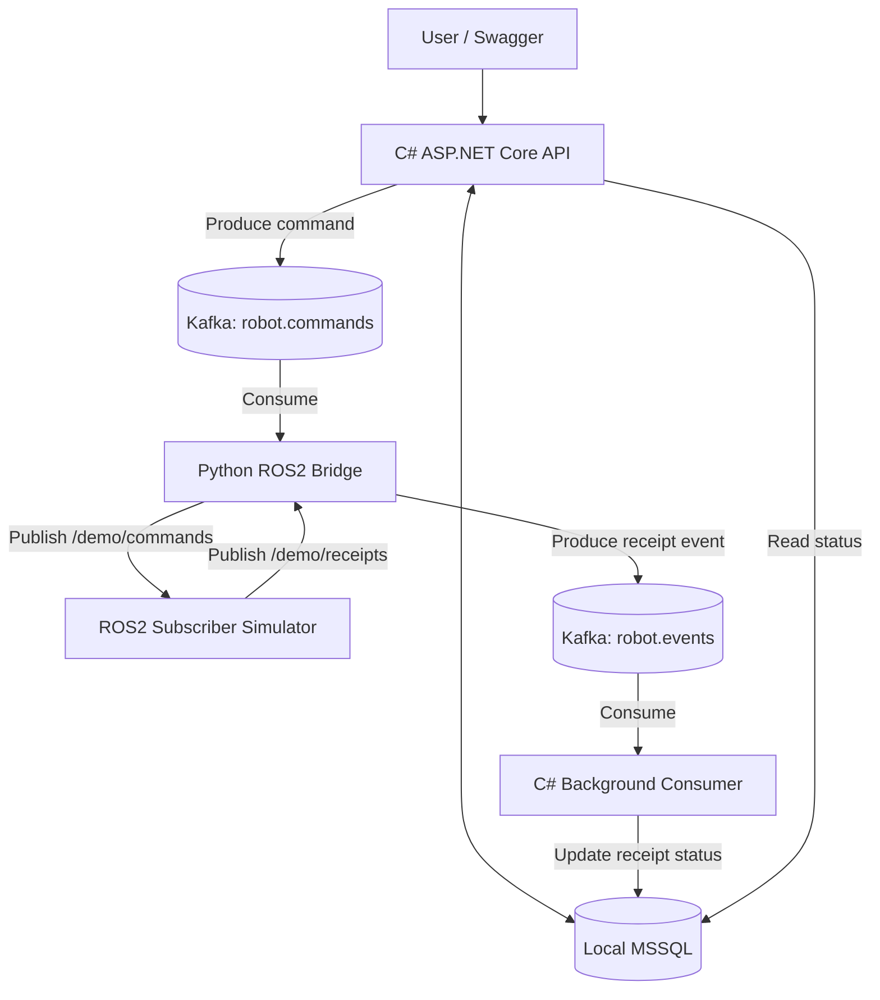

# Robotics Fleet Operations Platform — Architecture v1.1 (Approved)

> Status: **Approved / Baseline**  
> Date: 2026-11-09  
> Phase: Planning only; no implementation or cloud resources provisioned  
> Timebox: 4 weeks × 4 days × 8–10 hours (128–160 hours)

## 1. Objective and scope

Build a reproducible **software-only** end-to-end demonstration of event-driven integration between C# ASP.NET Core, Microsoft SQL Server, Apache Kafka, Python ROS2 Bridge, and ROS 2 Jazzy, with Docker, GitHub Actions/GHCR, Kubernetes, Prometheus and Grafana.

ROS2 only publishes and simulates receiving messages; **no robot task, navigation or movement logic**. PLC is **out of scope** for this iteration. Detailed retry, timeout, idempotency, outbox, recovery and failure handling are **deferred decisions**, not MVP acceptance criteria.

## 2. Logical architecture

**Kafka** connects application and robotics integration boundaries; **ROS2 DDS** handles communication between ROS2 nodes. The SQL database stores records; it is not the message transport. Diagram arrows are logical, not a guarantee of exactly-once delivery.

## 3. Minimal end-to-end demonstration

1. User POSTs a text payload to C# API.
2. API persists message ID, payload and initial status in MSSQL.
3. API produces a command event with the same correlation ID to `robot.commands`.
4. Python Bridge consumes the command and publishes it to ROS2 topic `/demo/commands`.
5. Simulated ROS2 subscriber receives the message and publishes a receipt on `/demo/receipts`.
6. Bridge produces the receipt event to `robot.events`.
7. C# background consumer updates the corresponding MSSQL record.
8. User GETs the message and sees its received status.

Receipt means **application-level simulated subscriber receipt**, not physical execution or a guarantee of exactly-once processing.

## 4. Component responsibilities

| Component | Responsibility |
|---|---|
| ASP.NET Core API | HTTP endpoints, persistence, command event production, status queries |
| MSSQL | Store message ID, payload, status and timestamps |
| Apache Kafka | Two event topics (`robot.commands`, `robot.events`); local single-broker KRaft for demo |
| Python ROS2 Bridge | Kafka consumer/producer and ROS2 topic translation |
| ROS2 Jazzy simulator | Subscribe to command topic and publish a simulated receipt |
| Docker Compose | Reproducible local integration environment |
| GitHub Actions + GHCR | Test, build and publish images; deploy/smoke-test as time allows |
| Kubernetes | Deploy selected application components; no requirement to run every ROS2 component inside K8s |
| Prometheus + Grafana | Basic service metrics and dashboards |

## 5. Database decision

**Default:** local SQL Server (container if compatible with host and resource limits). **Optional:** Azure SQL Database only after free-tier eligibility, network restrictions and potential charges are verified. Cloud DB is not required for the MVP.

## 6. Implementation boundaries

- No PLC, physical hardware, SLAM, Gazebo, multi-robot fleet control, web frontend, Schema Registry, Kafka Connect or multi-broker Kafka cluster.
- No promise of durable end-to-end exactly-once semantics.
- Advanced error handling, retries, idempotency, transactional outbox and failure injection are reserved for a final scope review; they must not block the core demo.
- Kubernetes deployment is a separate milestone after Docker Compose end-to-end success.

## 7. Four-week milestones

| Week | Target | Acceptance |
|---|---|---|
| 1 | C# API + MSSQL + Kafka baseline | HTTP request stored and command visible on Kafka |
| 2 | Python Bridge + ROS2 publisher/subscriber + Kafka return event | Complete end-to-end receipt persisted and queryable |
| 3 | CI/CD + GHCR + Kubernetes + basic metrics | Build/test/push and selected service deployment demonstrated |
| 4 | Integration polish, docs, repeatable demo | README, architecture diagram, demo walkthrough; decide whether any error handling fits remaining time |

## 8. Deferred architecture details

The following will be defined in later Markdown documents before coding: exact API routes and JSON schema, correlation IDs, topic payload format, message status schema, Kafka offset strategy, process boundaries, network setup for DDS, CI/CD environments, Kubernetes deployment boundary, secrets handling and Azure SQL option.

## 9. Decision record

- **Approved:** Kafka-based application ↔ ROS2 bridge messaging with ROS2 DDS internally.
- **Approved:** ROS2 message-send/receive simulation only; PLC excluded.
- **Approved:** local MSSQL baseline; Azure SQL optional.
- **Deferred:** detailed error handling and reliability guarantees.
- **Next document:** `requirements_v1.0.md` (functional requirements and MVP acceptance criteria).
