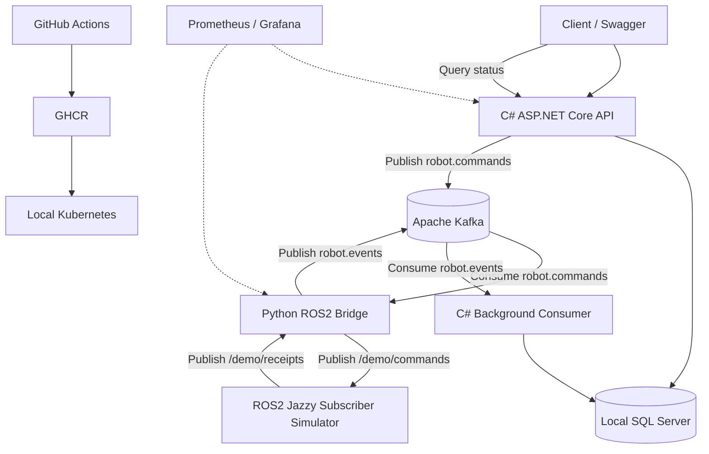

# Robotics Fleet Operations Platform — Codex Handoff

> Status: Architecture v1.1 approved; implementation plan ready for review.  
> Date: 2026-11-10  
> Purpose: Give Codex a stable, bounded specification for building a demonstrable GitHub portfolio project.

## 1. Objective and scope

Build a **software-only, reproducible, cloud-native integration demo** connecting **C# ASP.NET Core, Microsoft SQL Server, Apache Kafka, Python ROS2 Bridge, ROS2 Jazzy, Docker, GitHub Actions, Kubernetes, Prometheus and Grafana**.

The primary demonstration is an **end-to-end message exchange**, not robot navigation or business task execution:

1. A client sends a message/command to the C# REST API.
2. The API records the request in SQL Server and publishes a corresponding event to Kafka (`robot.commands`).
3. A Python bridge consumes the Kafka message and publishes it to a ROS2 topic.
4. A simulated ROS2 subscriber receives the message and publishes a simple receipt event on a second ROS2 topic.
5. The bridge publishes the receipt to Kafka (`robot.events`).
6. A C# background consumer receives the event and updates the SQL Server record.
7. A client queries the API to see the final state.

**Important:** SQL Server does not directly send messages to Kafka; the application coordinates persistence and publication. A Kafka producer acknowledgement is not proof that a ROS2 subscriber processed the message. A ROS2 receipt is an **application-level acknowledgement**, separate from DDS QoS.

### In scope

- ASP.NET Core REST API and background Kafka consumer
- SQL Server via EF Core and migrations
- Kafka topics `robot.commands` and `robot.events`, one local development broker (KRaft)
- Python Kafka-to-ROS2 bridge and ROS2-to-Kafka event publication
- ROS2 Jazzy publisher/subscriber simulation, no physical robot
- Docker Compose local development, GitHub Actions build/test/image publishing to GHCR
- Local Kubernetes deployment for suitable application services
- Basic health checks, structured logs, Prometheus metrics and Grafana dashboard
- README, architecture diagrams, tests and a repeatable demonstration

### Explicitly out of scope for the four-week MVP

- PLC or Mitsubishi integration (possible future extension only)
- Robot task logic, navigation, SLAM, Gazebo, real motors or sensors
- Multi-robot fleet orchestration, complex UI, Kafka multi-broker HA, service mesh
- Comprehensive retries, transactional outbox, exactly-once guarantees, advanced idempotency, DLQ and disaster recovery **unless later explicitly approved**
- Paid cloud infrastructure as a prerequisite

## 2. Approved architectural boundaries



Logical diagram only. Do **not** interpret Kafka-to-bridge and bridge-to-Kafka arrows as requiring two separate Kafka brokers. Do **not** assume every ROS2 process must run in Kubernetes.

### Component ownership

| Component | Responsibility |
|---|---|
| C# API | Validate requests, assign correlation/message ID, persist request state, publish Kafka command, query status |
| C# event consumer | Consume receipt events and update persisted state |
| SQL Server | Durable application state and event/message history as needed |
| Kafka | Asynchronous boundary between enterprise backend and robotics integration layer |
| Python bridge | Translate Kafka messages to ROS2 topics and ROS2 receipt topics back to Kafka |
| ROS2 simulator | Receive messages and emit simple receipt; no robot control logic |
| GitHub Actions / GHCR | Test, build and publish images; deploy only to a reachable, explicitly configured environment |
| Kubernetes | Deploy and operate suitable services; ROS2 DDS networking must be validated before deciding whether to containerize ROS2 nodes in-cluster |
| Prometheus / Grafana | Observe API/bridge availability and message processing metrics |

## 3. Minimal proposed message contract (subject to detailed contract document)

Keep the same `messageId` across HTTP, Kafka, ROS2 and database.

**HTTP request** `POST /api/messages`:

```json
{"content":"Hello ROS2"}
```

**Kafka command** (`robot.commands`):

```json
{"messageId":"<uuid>","type":"PING","content":"Hello ROS2","createdAt":"<UTC ISO-8601>"}
```

**Kafka receipt** (`robot.events`):

```json
{"messageId":"<same uuid>","type":"RECEIVED","source":"ros2-simulator","receivedAt":"<UTC ISO-8601>"}
```

**HTTP status query** `GET /api/messages/{messageId}` returns message ID, content, status and relevant timestamps. Suggested statuses: `Pending`, `Acknowledged`, optionally `Failed` or `TimedOut` if error-handling scope is approved later.

These are starting contracts, not a mandate to implement more features. Document exact ROS2 topic names and ROS2 message types before coding the bridge.

## 4. Database strategy

- **Baseline:** local Microsoft SQL Server, preferably via a Docker container with a persistent volume. EF Core SQL Server provider.
- **Optional later:** Azure SQL Database only after verifying free-tier eligibility, networking and billing controls. No Azure account or paid service should be required to run the project.
- Keep connection strings and credentials out of source control; use local ignored environment files and Kubernetes Secrets (for demo only; do not claim this constitutes production-grade secret management).
- Avoid premature database complexity. Start with one message record table; expand only for actual requirements.

## 5. Delivery architecture and practical constraints

1. First prove API + SQL Server locally.
2. Prove Kafka producer/consumer with minimal messages.
3. Prove ROS2 publish/subscribe independently.
4. Integrate bridge and verify complete message round-trip in Docker Compose / WSL.
5. Add CI and image publishing.
6. Deploy suitable services to local Kubernetes and validate network paths. Keep ROS2 simulation outside Kubernetes if DDS discovery/networking makes the in-cluster version unnecessarily complex.
7. Add metrics, dashboards, smoke tests and documentation.

Use existing Windows 11 + WSL2 Ubuntu + Docker Desktop + VS Code environment where available. No extra hardware. GitHub-hosted CI cannot automatically deploy to a private local cluster; document and choose an explicit deployment mechanism (e.g., a local self-hosted runner or a manual local deployment step), and avoid exposing the local cluster publicly merely for convenience.

## 6. Four-week target

Target **4 days/week, 8–10 hours/day, total 128–160 hours**, with approximately 144 hours as a planning baseline. This is a goal, not a guaranteed estimate.

| Week | Focus | Acceptance |
|---|---|---|
| 1 | Repo skeleton, C# API, SQL Server, Docker Compose, Kafka fundamentals | API persists a message; a minimal Kafka producer and consumer exchange a message |
| 2 | ROS2 Jazzy simulator and Python bridge | End-to-end API → Kafka → ROS2 → Kafka → SQL status update works locally |
| 3 | GitHub Actions, GHCR, Kubernetes, Prometheus/Grafana | Automated tests/builds and reproducible deployment with basic health/metrics |
| 4 | End-to-end testing, demo, documentation and optional reliability improvements | A new developer can reproduce the demo and verify the complete flow |

**Scope protection:** If behind schedule, prioritize the working end-to-end flow and reproducible instructions over optional hardening and extra components.

## 7. AI-assisted engineering working agreement

- Codex may generate the bulk of scaffolding, implementation and configuration.
- The human owner approves architecture and trade-offs, runs or reviews tests, validates outputs and leads troubleshooting with evidence.
- For unfamiliar critical technologies (Kafka offset handling, ROS2 topics/QoS, Kubernetes networking), explain the minimum essential concepts and provide a small reproducible verification step.
- Do not claim a command, test, deployment or Git commit succeeded unless actually executed and verified.
- Keep code simple, readable and maintainable; avoid speculative abstractions.
- At meaningful milestones, propose a Git commit and a concise commit message. Do not commit without approval if operating interactively.
- Record unresolved limitations transparently, especially delivery guarantees, consumer offsets and cross-system consistency.

## 8. Codex execution instructions

**Start with planning and repository inspection; do not implement the entire project in one pass.**

1. Read this document and any existing project files before proposing changes.
2. Draft `docs/requirements_v1.0.md` with Must Have / Should Have / Out of Scope and testable acceptance criteria.
3. Draft `docs/communication_contract_v1.0.md` covering HTTP, Kafka topics, ROS2 topics, correlation IDs and minimal receipt semantics.
4. Draft `docs/data_model_v1.0.md` and `docs/deployment_design_v1.0.md`.
5. Draft `docs/roadmap_4weeks_v1.0.md` and `docs/week01_plan_v1.0.md`.
6. Ask for review of significant design choices before implementation. After approval, implement Week 1 only, run available checks and report evidence.
7. Do not silently introduce PLC, robot navigation, Kafka HA, new infrastructure or advanced reliability patterns.

**Definition of Done (MVP):** A documented, software-only run demonstrates an HTTP message created in C#, persisted in SQL Server, transmitted via Kafka and ROS2 to a simulator, acknowledged via ROS2 and Kafka, and reflected in the API/database; the application is testable, containerized, and has a documented CI/Kubernetes/monitoring path.

## 9. Known design questions for later review

- Whether to keep the C# Kafka producer in the API process and consumer in a hosted background service, or separate them operationally
- Whether to use an existing ROS2 standard message type or a tiny custom interface for correlation IDs
- Precise Kafka consumer offset commit behavior and how to handle duplicate receipts
- How to run ROS2 DDS reliably in Docker / WSL and whether Kubernetes should host any ROS2 components
- Whether to add basic timeout, retry, idempotency or an outbox in Week 4
- Whether Azure SQL's free offering is eligible and worthwhile

These are **deferred decisions**, not permission to expand the initial scope.
